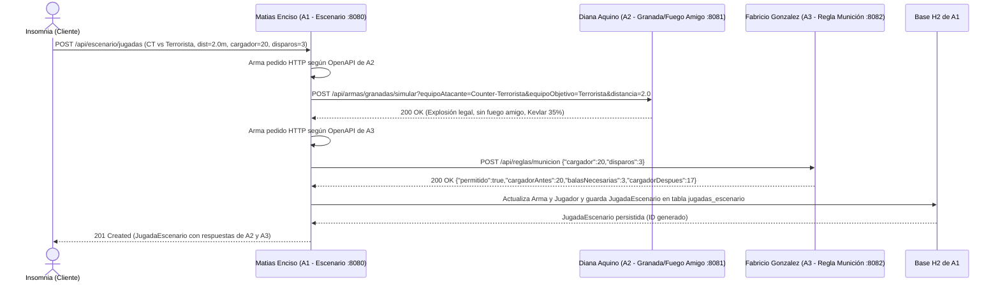
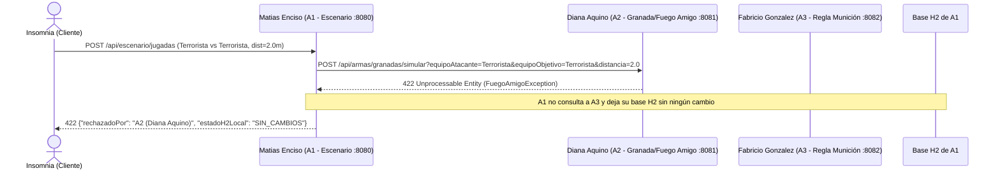
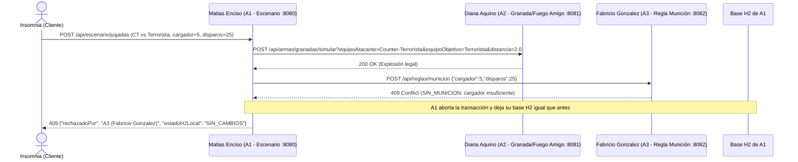

# menciso-tp-lp3-2026

**Asignatura:** Lenguaje de Programación 3 (CYT646) — Edición 2026  
**Ejercicio:** POO-09 (Challenge de APIs cruzadas, OpenAPI y cierre de observaciones de POO-08)  
**Dominio:** Counter-Strike 2 (CS2)  
**Autor:** Matias Enciso (`A1`)  
**Grupo CS2:** Matias Enciso (`A1`) · Diana Aquino (`A2`) · Fabricio Gonzalez (`A3`)  
**Licencia:** [Apache License 2.0](LICENSE)  

---

## 1. Cierre de Observaciones de POO-08 (Los 3 puntos de corrección)

En cumplimiento de la tabla de los 3 puntos de POO-09, **todas** las observaciones del documento de corrección de POO-08 fueron cerradas y verificadas con **22 pruebas automatizadas (`22/22 BUILD SUCCESS`)**:

| Criterio observado en POO-08 | Observación del profesor | Cómo se cerró en esta entrega |
| :--- | :--- | :--- |
| **Criterio 2: Organización en paquetes (Separación de 3 capas)** *(tenía 1/3)* | 1) `ArmaController` recibía `ArmaRepository` y `JugadorRepository` y llamaba a `findAll()` en `/armas/comportamiento` y `/armas/catalogo-ui`. Además, el `GET` de `SimulacionExplosionController` armaba él mismo la `Granada`, el `Blindaje` y el `Jugador`. <br> 2) El dominio (`Arma`, `ArmaDeFuego`, `Granada`, `Jugador`, `Blindaje`) lanzaba las excepciones y tenía las reglas de negocio. Las validaciones, reglas y excepciones van en `service`; el dominio/`Entity` solo guarda el estado encapsulado. <br> 3) *Mejora:* `GlobalExceptionHandler` encaja mejor en `rest.controller`. | 1) Se eliminaron `ArmaRepository` y `JugadorRepository` de `ArmaController` (ahora delega todo en `ArmaService.obtenerComportamientoPolimorfico()` y `ArmaService.obtenerCatalogoUI()`), y `SimulacionExplosionController` delega la preparación de objetos en `SimulacionExplosionService.simularConParametros(...)`. <br> 2) Se eliminaron **todos** los `throw new ...` y métodos de reglas de las clases de `domain` (`Arma`, `ArmaDeFuego`, `Pistola`, `Granada`, `Jugador`, `Blindaje`), dejándolas solo con su estado encapsulado (`private`), constructores, getters/setters y `ejecutarAccion()`. Todas las validaciones, las dos reglas de negocio y las excepciones viven ahora en `ArmaService`, `SimulacionExplosionService` y `EscenarioCruzadoService`. <br> 3) Se movió `GlobalExceptionHandler` al paquete `py.edu.uc.lp3.me.cs2.rest.controller`. |
| **Criterio 3: Ocultamiento e invariantes (`municionCargador <= capacidadCargador`)** *(tenía 0/3)* | Un `POST` de una `Pistola` con `municionCargador: 500` y `capacidadCargador: 20` respondió `201` y quedó guardada con más balas que su capacidad. Además, cuando la simulación recibía la granada en el JSON (sin `armaId`), la guardaba sin pasar por `validarArma`. | Se quitó de `ArmaDeFuego.setMunicionCargador` el ajuste que agrandaba `capacidadCargador` automáticamente, y se agregó en `ArmaService.validarArma()` la validación estricta de CS2: **`municionCargador <= capacidadCargador`**, `capacidadCargador > 0`, `municionCargador >= 0`, `municionReserva >= 0`, `daño >= 0`, `0 <= precision <= 100`, `radioExplosion > 0` y `tiempoActivacion >= 0`. Un `POST /api/armas` con `municionCargador: 500` y `capacidadCargador: 20` ahora responde **`400 Bad Request` (`ParametroInvalidoException`)** y no guarda nada en H2 (comprobado en `ArmaCrudTests.testValidacionMunicionSuperaCapacidadCargadorLanzaExcepcion`). En `SimulacionExplosionService` ahora se validan siempre el arma, el jugador y el blindaje sin importar si llegan por ID o en el JSON. |
| **Criterio 4 y 6: Mejoras sugeridas (`UI.Capable` y `GET /demo`)** | 1) La interfaz anidada `UI.Capable` repetía a `UICapable`. <br> 2) `GET /api/simulacion/explosion/demo` ejecutaba la simulación y guardaba el resultado en un `GET`. | 1) Se eliminó `UI.java` (`UI.Capable`), dejando únicamente `UICapable.java`. <br> 2) `GET /api/simulacion/explosion/demo` ahora llama a `simularDemoLectura()` (`@Transactional(readOnly = true)`) y no modifica datos en H2. |
| **Criterio 8: Documentación** *(tenía 2/3)* | 1) El README explicaba `spring.jpa.database-platform=org.hibernate.dialect.H2Dialect`, que no estaba en `application.properties`. <br> 2) El archivo `ESPECIFICACIONES.md` de Classroom enlazaba un commit anterior (`45e9ca6...`). <br> 3) *Mejora:* En «PUT y PATCH» decir una sola cosa, la que hace el código. | 1) Se alineó la sección de propiedades de H2 del README línea por línea con `application.properties`. <br> 2) Se sincronizó el enlace exacto al commit en `README.md`, `BITACORA.md` y `ESPECIFICACIONES.md`. <br> 3) En «PUT y PATCH» se documentó exactamente el comportamiento del código (asigna `default_weapon.png` y `default_sound.wav` si se omiten). |

---

## 2. Mapa del Grupo Round Robin (POO-09: A1, A2 y A3)

Dominio del grupo: **Counter-Strike 2 (CS2)**.

| Rol | Integrante | Repositorio de GitHub | URL Base Local | URL del Documento OpenAPI 3 | Las dos reglas publicadas por el dueño (en una frase) |
| :---: | :--- | :--- | :--- | :--- | :--- |
| **A1 (Propio)** | **Matias Enciso** | [MatiasEnc/menciso-tp-lp3-2026](https://github.com/MatiasEnc/menciso-tp-lp3-2026) | `http://localhost:8080` | JSON: `http://localhost:8080/v3/api-docs` <br> UI: `http://localhost:8080/swagger-ui.html` y `/swagger-ui/index.html` | **Regla 1 (`POST /api/armas/{id}/disparar` y simulación):** Consume munición del cargador o carga única de granada calculando atenuación por distancia y fuego amigo al 35% (`400` / `409`). **Regla 2 (`/api/simulacion/explosion`):** El blindaje Kevlar absorbe un porcentaje del impacto desgastando su durabilidad y descuenta el daño residual de la vida del jugador en H2. |
| **A2 (Compañera 1)** | **Diana Aquino** | [dianamariapaz2104/daquino-tp-lp3-2026](https://github.com/dianamariapaz2104/daquino-tp-lp3-2026) | `http://localhost:8081` | JSON: `http://localhost:8081/v3/api-docs` <br> UI: `http://localhost:8081/swagger-ui/index.html` | **Regla 1 (`POST /api/armas/1/recargar?balas=5`):** Valida que las balas a recargar sean positivas y no superen el tope del cargador (`409`). **Regla 2 consultada (`POST /api/armas/granadas/simular?equipoAtacante=Counter-Terrorista&equipoObjetivo=Terrorista&distancia=2.0`):** Calcula el daño explosivo por radio (5m) con absorción de Kevlar (35%), rechazando distancias inválidas (`400`) o fuego amigo entre el mismo equipo (`422 FuegoAmigoException`). |
| **A3 (Compañero 2)** | **Fabricio Gonzalez** | [FabricioG29/fg-taller-git-2026](https://github.com/FabricioG29/fg-taller-git-2026) | `http://localhost:8082` | JSON: `http://localhost:8082/v3/api-docs` <br> UI: `http://localhost:8082/swagger-ui.html` | **Regla 1 consultada (`POST /api/reglas/municion`):** Recibe `{"cargador":20,"disparos":3}` y responde `200` si la munición alcanza para la ráfaga o `409 SIN_MUNICION` si no alcanza. **Regla 2 (`POST /api/reglas/danio`):** Recibe `{"vida":100,"armadura":100,"danio":36}` y calcula la vida y chaleco restantes (absorbe la mitad) o rechaza con `422 JUGADOR_ELIMINADO` si la vida ya es `0`. |

---

## 3. Cómo Clonar y Arrancar los Tres Servicios (A1, A2 y A3)

Para probar el escenario completo en la misma máquina en tres terminales (primero deben estar arriba **A2** y **A3**, y por último se ejecuta el escenario en **A1**):

### Terminal 1 — Clonar y Arrancar A2 (Diana Aquino) en el puerto `8081`:
```bash
git clone https://github.com/dianamariapaz2104/daquino-tp-lp3-2026.git
cd daquino-tp-lp3-2026
./mvnw spring-boot:run -Dspring-boot.run.arguments=--server.port=8081
```

### Terminal 2 — Clonar y Arrancar A3 (Fabricio Gonzalez) en el puerto `8082`:
```bash
git clone https://github.com/FabricioG29/fg-taller-git-2026.git
cd fg-taller-git-2026
./mvnw spring-boot:run -Dspring-boot.run.arguments=--server.port=8082
```

### Terminal 3 — Arrancar A1 Propio (Matias Enciso) en el puerto `8080`:
```bash
git clone https://github.com/MatiasEnc/menciso-tp-lp3-2026.git
cd menciso-tp-lp3-2026/cs2
./mvnw spring-boot:run
```

Si A2 o A3 corren en otras notebooks de la sala, las URLs se configuran por variables de entorno sin tocar el código:
```bash
A2_BASE_URL=http://10.40.22.56:8080 A3_BASE_URL=http://10.40.143.189:8080 ./mvnw spring-boot:run
```

Para ejecutar las **22 pruebas automatizadas** (que levantan servidores HTTP embebidos para verificar el camino feliz y los rechazos de A2 y A3):
```bash
cd cs2
./mvnw test
```

---

## 4. Diagramas de Secuencia del Escenario Cruzado (Mermaid)

El escenario propio se llama **«Asalto Táctico Coordinado CS2 (Granada de Apertura + Ráfaga de Remate)»** (`POST /api/escenario/jugadas`). Para que la jugada sea legal y se guarde en el H2 de **A1 (Matias Enciso)**, primero **A2 (Diana Aquino)** debe aprobar que la granada de apertura sea a distancia válida y sin fuego amigo, y luego **A3 (Fabricio Gonzalez)** debe aprobar que el cargador del arma tiene munición suficiente para la ráfaga de remate.

### A. Camino Feliz (`201 Created` — A2 y A3 aceptan y A1 persiste la jugada en su H2)



### B. Rechazo de A2 — Diana Aquino (`422 FuegoAmigoException` — El H2 de A1 queda intacto)



### C. A2 acepta pero A3 — Fabricio Gonzalez rechaza (`409 SIN_MUNICION` — El H2 de A1 queda intacto)



---

## 5. Respuestas a «Qué hay que pensar» (POO-09 y POO-08)

### Preguntas de POO-09 (Challenge de APIs Cruzadas)
* **OpenAPI:** Nuestro documento OpenAPI 3.0.3 vive en `GET http://localhost:8080/v3/api-docs` (y cuenta con visor Swagger UI en `http://localhost:8080/swagger-ui.html` y `http://localhost:8080/swagger-ui/index.html`). Allí están documentados con esquemas, ejemplos y códigos de error (`400`, `404`, `409`, `422`) la simulación `/api/simulacion/explosion`, las reglas `/api/armas/{id}/disparar` y `/api/armas/{id}/recargar`, el CRUD `/api/armas`, el catálogo `/armas/catalogo-ui` y el escenario cruzado `/api/escenario/jugadas`.
* **Grupo:** Somos un trío del dominio **Counter-Strike 2**: **A1** es **Matias Enciso** ([repositorio](https://github.com/MatiasEnc/menciso-tp-lp3-2026)), **A2** es **Diana Aquino** ([repositorio](https://github.com/dianamariapaz2104/daquino-tp-lp3-2026)) y **A3** es **Fabricio Gonzalez** ([repositorio](https://github.com/FabricioG29/fg-taller-git-2026)). De A2 consultamos su regla de explosión de granada y bloqueo de fuego amigo (`POST /api/armas/granadas/simular`), y de A3 consultamos su regla de suficiencia de munición en el cargador (`POST /api/reglas/municion`).
* **Escenario:** El hecho del juego es un **«Asalto Táctico Coordinado CS2 (Granada + Ráfaga)»**: para ejecutar la entrada táctica sobre un objetivo se necesita que **A2** valide que la granada de apertura esté en rango y no hiera a un compañero de equipo, y que **A3** valide que el arma tenga balas suficientes en el cargador para la ráfaga de remate. Después de un escenario exitoso (`201 Created`), un `GET /api/escenario/jugadas` muestra la jugada guardada en la tabla `jugadas_escenario` de H2 (y se descuentan las balas del arma y la vida/blindaje del jugador en H2). Si A2 acepta y A3 rechaza (o si A2 rechaza de entrada), la transacción se aborta y las tablas `jugadas_escenario`, `armas` y `jugadores` del H2 de A1 quedan exactamente igual que antes.
* **Cliente:** `CompaneroApiClient` (en el paquete `service`) usa `java.net.http.HttpClient` de Java 21 e inyecta las URLs y rutas desde `application.properties` (`cs2.a2.base-url`, `cs2.a2.endpoint`, `cs2.a3.base-url`, `cs2.a3.endpoint`), que a su vez leen las variables de entorno `A2_BASE_URL`, `A2_ENDPOINT`, `A3_BASE_URL` y `A3_ENDPOINT`.
* **Errores y disponibilidad:** Cuando A2 o A3 devuelven un error (`400`, `409`, `422`) o no responden (`503`), `CompaneroApiClient` lanza `RechazoCompaneroException` indicando `rolCompanero` (`"A2"` o `"A3"`), `rechazadoPor` (`"A2 (Diana Aquino)"` o `"A3 (Fabricio Gonzalez)"`), `urlConsultada`, `codigoHttpCompanero` y `estadoH2Local: "SIN_CAMBIOS"`. Además, tanto en este README como en la colección de Insomnia (`insomnia/insomnia-cs2-poo09.json`) dejamos guardadas las respuestas de ejemplo del camino feliz y de cada rechazo por si algún compañero está apagado al momento de corregir.
* **Pregunta de anclaje de POO-09 (*¿Si el compañero cambia el nombre de una ruta, alcanza con actualizar lo que dice el OpenAPI, o había código copiado de su dominio?*):** Alcanza con actualizar la propiedad `cs2.a2.endpoint` o `cs2.a3.endpoint` en `application.properties` (o la variable de entorno `A2_ENDPOINT` / `A3_ENDPOINT`) según lo que publique su nuevo OpenAPI, porque no copiamos ninguna clase del dominio de Diana ni de Fabricio: la comunicación es 100% por HTTP/JSON a través de `CompaneroApiClient`.

---

## 6. Propiedades de H2 y Configuración (`src/main/resources/application.properties`)

* `spring.application.name=menciso-tp-lp3-2026`: Define el nombre identificador de la aplicación dentro de Spring Boot.
* `server.port=${PORT:8080}`: Permite arrancar el servicio en el puerto `8080` por defecto o cambiarlo por variable/argumento al correr los tres servicios del grupo.
* `spring.datasource.url=jdbc:h2:file:./data/armas;AUTO_SERVER=TRUE`: Configura H2 para guardar los datos en disco dentro de `./data/armas` (para que persistan al reiniciar) y permite conexiones concurrentes.
* `spring.datasource.driverClassName=org.h2.Driver`: Especifica el driver JDBC oficial del motor H2.
* `spring.datasource.username=sa`: Define el usuario administrador por defecto de la base de datos local.
* `spring.datasource.password=`: Deja la contraseña vacía para el entorno de desarrollo local.
* `spring.jpa.hibernate.ddl-auto=update`: Hace que Hibernate cree o actualice automáticamente las tablas (`armas`, `jugadores` y `jugadas_escenario`) a partir de las clases `@Entity` sin borrar los datos existentes.
* `spring.jpa.open-in-view=false`: Desactiva el patrón Open Session in View para cerrar las sesiones de base de datos apenas termina la transacción de la capa `service`.
* `spring.jpa.show-sql=true`: Muestra en la consola las consultas SQL que Hibernate ejecuta contra H2.
* `spring.jpa.properties.hibernate.format_sql=true`: Formatea e indenta las sentencias SQL en la consola para que sean legibles.
* `spring.h2.console.enabled=true`: Habilita la consola visual web de H2 para inspeccionar las tablas desde el navegador.
* `spring.h2.console.path=/h2-console`: Define la ruta URL (`http://localhost:8080/h2-console`) donde se accede a la consola H2.
* `cs2.a2.base-url` / `cs2.a2.endpoint`: URL base (`http://localhost:8081`) y ruta (`/api/armas/granadas/simular`) del servicio de A2 (Diana Aquino).
* `cs2.a3.base-url` / `cs2.a3.endpoint`: URL base (`http://localhost:8082`) y ruta (`/api/reglas/municion`) del servicio de A3 (Fabricio Gonzalez).

---

## 7. Diagrama de Clases Actualizado (Mermaid)

```mermaid
classDiagram
    class UICapable {
        <<interface>>
        +getImagen()* String
        +setImagen(imagen)* void
        +getSonido()* String
        +setSonido(sonido)* void
    }

    class Arma {
        <<abstract>>
        -Long id
        -String nombre
        -int precio
        -Equipo equipo
        -String imagen
        -String sonido
        #Arma()
        +ejecutarAccion()* String
        +ejecutarAccion(repeticiones)* String
    }

    class ArmaDeFuego {
        <<abstract>>
        -double daño
        -double precision
        -int municionCargador
        -int municionReserva
        -int capacidadCargador
        #ArmaDeFuego()
    }

    class Pistola {
        -boolean esSilenciada
        #Pistola()
        +ejecutarAccion() String
    }

    class Granada {
        -double daño
        -double radioExplosion
        -double tiempoActivacion
        -boolean esLetal
        -String efecto
        -boolean lanzada
        #Granada()
        +ejecutarAccion() String
    }

    class Jugador {
        -Long id
        -String nombre
        -double vida
        -Equipo equipo
        -Blindaje blindaje
        -boolean vivo
        #Jugador()
    }

    class Blindaje {
        <<embeddable>>
        -String tipo
        -double durabilidad
        -double porcentajeAbsorcion
    }

    class JugadaEscenario {
        -Long id
        -String nombreEscenario
        -Long armaId
        -Long jugadorObjetivoId
        -String validacionA2Diana
        -String validacionA3Fabricio
        -String estadoJugada
    }

    class ArmaRepository {
        <<interface>>
    }

    class JugadorRepository {
        <<interface>>
    }

    class JugadaEscenarioRepository {
        <<interface>>
    }

    class CompaneroApiClient {
        +consultarReglaA2Diana(equipoAtacante, equipoObjetivo, distancia) String
        +consultarReglaA3Fabricio(cargador, disparos) String
    }

    class EscenarioCruzadoService {
        +ejecutarEscenarioCruzado(request) JugadaEscenario
        +listarJugadas() List~JugadaEscenario~
    }

    class ArmaService {
        +validarArma(arma, esCreacion) void
        +dispararArma(id, cantidad) Arma
        +recargarArma(id) Arma
        +obtenerCatalogoUI() List
    }

    class SimulacionExplosionService {
        +simularImpactoPersistido(request) ResultadoSimulacion
        +aplicarImpactoAJugador(jugador, danio) double
    }

    class EscenarioCruzadoController {
        +ejecutarJugada(...) ResponseEntity
        +listarJugadas() ResponseEntity
    }

    class ArmaRestController {
        +crear(arma) ResponseEntity
        +listarTodas() ResponseEntity
    }

    class ArmaException {
        +ArmaException(message)
    }

    class ParametroInvalidoException {
        +ParametroInvalidoException(message)
    }

    class MunicionInsuficienteException {
        +MunicionInsuficienteException(message)
    }

    class RechazoCompaneroException {
        +getRolCompanero() String
        +getRechazadoPor() String
    }

    class GlobalExceptionHandler {
        +handleParametroInvalidoException(ex) ResponseEntity
        +handleMunicionInsuficienteException(ex) ResponseEntity
        +handleRechazoCompaneroException(ex) ResponseEntity
    }

    UICapable <|.. Arma : implements
    UICapable <|.. Jugador : implements
    Arma <|-- ArmaDeFuego : extends
    Arma <|-- Granada : extends
    ArmaDeFuego <|-- Pistola : extends
    Jugador *-- Blindaje : contiene
    EscenarioCruzadoController --> EscenarioCruzadoService : usa
    EscenarioCruzadoService --> CompaneroApiClient : consulta A2 y A3
    EscenarioCruzadoService --> JugadaEscenarioRepository : persiste
    ArmaRestController --> ArmaService : usa
    ArmaService --> ArmaRepository : usa
    ArmaException <|-- ParametroInvalidoException : extends
    ArmaException <|-- MunicionInsuficienteException : extends
    ArmaException <|-- RechazoCompaneroException : extends
    GlobalExceptionHandler ..> ArmaException : maneja por tipo
```



---

## 8. Cómo Importar y Recorrer la Colección de Insomnia (POO-09 y POO-08)

Archivo de la colección: `insomnia/insomnia-cs2-poo09.json` (también disponible en `insomnia/insomnia-cs2-poo08.json`).

1. Abrir **Insomnia** -> **Import** -> **From File** y seleccionar `insomnia/insomnia-cs2-poo09.json`.
2. Asegurarse de que **A2 (Diana Aquino)** esté arriba en `http://localhost:8081`, **A3 (Fabricio Gonzalez)** en `http://localhost:8082` y **A1 (Matias Enciso)** en `http://localhost:8080`.
3. Recorrer la carpeta **`1. POO-09 — OpenAPI y Escenario Cruzado (A1 -> A2 Diana y A3 Fabricio)`**:
   * **`01. OpenAPI Propio A1` (`GET /v3/api-docs`):** Muestra el documento OpenAPI 3.0.3 de Matias Enciso.
   * **`02. Escenario Cruzado - Camino Feliz` (`POST /api/escenario/jugadas`):** A2 (Diana) aprueba la explosión sin fuego amigo (`200 OK`) y A3 (Fabricio) aprueba que 20 balas alcanzan para la ráfaga de 3 disparos (`200 OK`). A1 persiste la jugada en H2 y responde **`201 Created`**.
   * **`03. Verificar Jugadas Persistidas en H2 de A1` (`GET /api/escenario/jugadas`):** Muestra la jugada guardada en H2.
   * **`04. Rechazo de A2 - Diana Aquino por Fuego Amigo` (`POST /api/escenario/jugadas`):** Envía `Terrorista` contra `Terrorista`. A2 responde **`422 Unprocessable Entity` (`FuegoAmigoException`)**. A1 informa `"rechazadoPor": "A2 (Diana Aquino)"` y `"estadoH2Local": "SIN_CAMBIOS"`.
   * **`05. Rechazo de A3 - Fabricio Gonzalez por SIN_MUNICION` (`POST /api/escenario/jugadas`):** A2 aprueba (`200 OK`), pero se piden `25` disparos con solo `5` balas en el cargador. A3 responde **`409 Conflict` (`SIN_MUNICION`)**. A1 informa `"rechazadoPor": "A3 (Fabricio Gonzalez)"` y `"estadoH2Local": "SIN_CAMBIOS"`.

---

## 9. Enlace al Commit de la Solución
* **Repositorio:** [https://github.com/MatiasEnc/menciso-tp-lp3-2026](https://github.com/MatiasEnc/menciso-tp-lp3-2026)
* **Commit de la solución:** [https://github.com/MatiasEnc/menciso-tp-lp3-2026/commit/a62d842c676353fdb03da87b74ee82fe5b0d3e8e](https://github.com/MatiasEnc/menciso-tp-lp3-2026/commit/a62d842c676353fdb03da87b74ee82fe5b0d3e8e)
